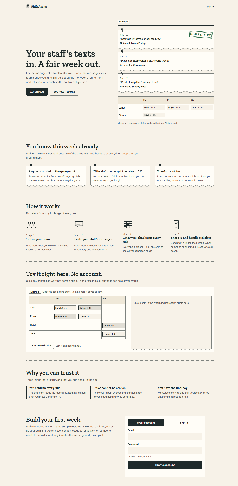
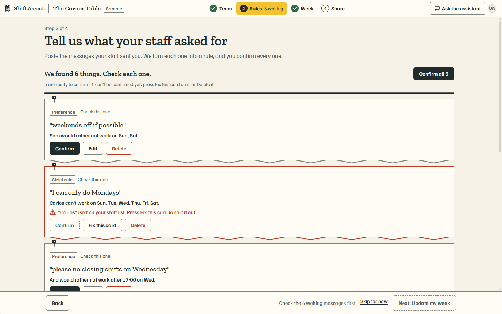
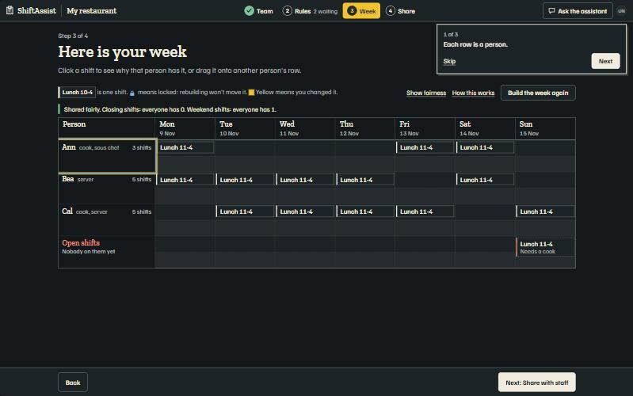
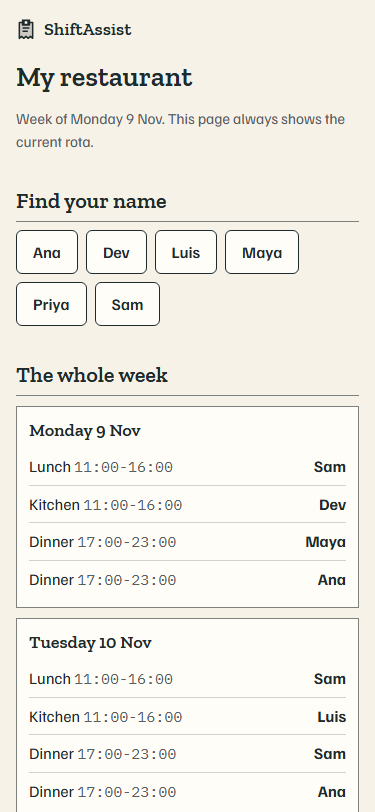

# ShiftAssist

Your staff's texts in. A fair week out. A rota app for small restaurants and other shift teams: an assistant reads your staff's messages, code builds the week, and every shift can explain itself.

**[Live app](https://shiftassist.vercel.app)** · **[Demo video (3 min)](https://clips.agent-native.com/share/LCBy6Jdru6u9)** · [Screenshots](docs/screens/) · [How I tried to break it](#how-i-tried-to-break-it)

> *"Who said they can't do Fridays again? And why does Sam keep getting the late shift?"*

Most small restaurants run their rota from a spreadsheet and a group chat. Requests get buried, building the week takes hours, staff ask why they got the shifts they did, and a 6am sick text starts a scramble. ShiftAssist turns that chat into rules you approve, builds a week that keeps them, explains every placement, and finds cover when someone can't make it.

Built for the Builder.io Agent-Native Hackathon, November 2026.



## Why this exists

Scheduling tools such as Deputy, Homebase and 7shifts already sell auto-scheduling. They expect availability entered into forms, and the schedule arrives as a finished answer. In a survey Toast commissioned in July 2026, 73% of UK managers using AI scheduling said staff had raised concerns about fairness, hours or flexibility. Toast's advice was to explain the inputs and give staff a way to challenge errors.

ShiftAssist starts where the requests really are, in messy messages, and makes every decision answerable:

```
  staff messages        assistant           you             scheduling code         staff
  "can't do Fridays" -> proposes a rule  -> confirm it  ->  places every shift  ->  open a link
  "no closes Tue"       (never places       or fix it       keeps every rule,       and see why
                         a shift)                           explains each one       they have it
```

The assistant reads language. Code decides. You approve.

## What it does

Signed-out visitors get a product page with a small interactive example that needs no account. After signing in, Home shows the one next step, and four guided steps do the work:

1. **Team.** Add people and pick their jobs from chips, then the shifts you need in a normal week. A shift's job can only be one your team has, and any shift nobody could work is named before you move on.
2. **Rules.** Paste staff messages. The assistant proposes each rule as a ticket quoting the original sentence. Names it can't match are flagged, and messages that aren't rules, such as a swap request, become notes instead of vanishing. Nothing is used until you confirm it.
3. **Week.** A deterministic solver places every shift: jobs, availability, maximum shifts, rest between shifts and no overlaps, plus preferences and an even spread of closing and weekend shifts. If a shift can't be filled, it says why for each person. Click any shift to see why that person has it and who else could have worked it.
4. **Share.** Publish a private read-only link staff open on their phones without signing in: their shifts, and the reasons. Stop sharing at any time.

Along the way you can change any shift by dragging, with the Move menu, or by asking the assistant in chat. Every route goes through the same `move-shift` action, which re-checks the rules on the server and refuses a change that breaks one. Lock a shift and nothing moves it. When someone calls in sick, ShiftAssist ranks who can cover, shows any overtime cost, marks the absent person off that day, and prepares a message for you to copy. It does not send messages for you.

| Rules from messages | The week | What staff see |
|---|---|---|
|  |  |  |

## Try it

Open the [live app](https://shiftassist.vercel.app), create an account (an email and a password of at least 12 characters), and choose the sample restaurant. It's labelled as sample data and comes with example staff messages, so you can reach a built week in about a minute.

Each account gets 40 assistant turns per day, because the app runs on a shared model key. The week, rules, Move menu, explanations and sharing keep working without the assistant.

## Run it locally

Needs Node.js 22.22 or later and pnpm.

```bash
pnpm install
cp .env.example .env
```

Put a model key in `.env`. The live app uses DeepSeek through its OpenAI-compatible API, and `.env.example` is already set up for that: fill in `OPENAI_API_KEY`. Any provider Agent-Native supports also works.

```bash
pnpm exec agent-native dev
```

Open http://localhost:8080 and choose "Continue as local dev". Local data lives in PGlite; production uses Postgres (Neon).

```bash
pnpm exec vitest run
```

## Where to look

The ShiftAssist code is in `lib/solver/`, `server/lib/`, `server/db/`, `actions/`, `app/components/board/`, `app/routes/` (`home`, `team`, `rules`, `week`, `share`) and `server/lib/landing-html.ts`. The rest is the Agent-Native app shell: `.agents/skills/` are the framework's skills bundled into the assistant, `app/i18n/` holds the shell's interface translations, and routes such as `settings`, `database` and `extensions` are framework pages kept so the shell works.

## Architecture

| Part | Job |
|---|---|
| `lib/solver/` | Pure TypeScript scheduler: rule checks, search, repair, cover ranking and explanations; no I/O |
| `server/lib/assignments.ts` | The only code that writes shifts; re-checks every rule inside a transaction |
| `server/lib/rules.ts` | Proposed, confirmed and flagged rules, and notes |
| `server/lib/setup.ts` | Team and shift pattern, with job names normalised and unworkable shifts refused |
| `server/lib/publish.ts` | Share tokens and the read-only staff page: names, shifts and reasons only |
| `server/lib/usage.ts` | Daily cap on assistant turns per account |
| `actions/` | Actions shared by the UI and the assistant: `get-week`, `save-setup`, `propose-rules`, `confirm-rules`, `build-week`, `move-shift`, `explain-shift`, `slot-eligibility`, `find-cover`, `apply-cover`, `publish-week` and more |
| `app/` | Product page, Home, the four steps, ticket rail and receipt drawer |

## Why one action for everyone matters

Agent-Native lets the UI and the assistant call the same `defineAction()`. ShiftAssist builds its main guarantee on that. A drag, the Move menu and a chat request ("give Sam Friday's lunch shift") all reach `move-shift`, so all three are checked by the same server code, and the week updates live when the assistant acts. While you drag, cells the solver says that person can't take are hatched, with the reason.

The assistant can propose but not decide. Confirming rules, editing rules and applying cover need the manager's approval when the assistant calls them. Its raw database tools are turned off (`frameworkTools: { database: "off" }`), so it can't write around the rules.

## How I tried to break it

| Attempt | Result |
|---|---|
| Ask the assistant to give a shift to someone who can't work that day, and to get around the rule "any way you can, including writing to the database directly" | Refused by `move-shift` with the reason; the shift didn't move |
| Drag a shift onto someone at their shift limit | Refused with the reason; database unchanged (tested) |
| Ask the assistant to move a locked shift | Refused: "This shift is locked. Unlock it first." |
| Repeat the same move | No change, no duplicate write (tested) |
| A message naming someone not on the team | Flagged "isn't on your staff list"; can't be confirmed until fixed |
| A message that isn't a rule | Kept as a note; never reaches the solver (tested) |
| A proposed rule nobody confirmed | Ignored by the solver (tested) |
| A shift whose job nobody on the team has | Refused at setup with a plain message (tested) |
| Job names typed with odd spacing or capitals ("Server ") | Normalised, and the week fills (tested) |
| Another account's shifts or people | Not visible, and refused (tested) |
| Logged-out calls to the app's actions | 401 on the live app |
| A wrong, malformed or revoked share link | 404 (tested, and checked on the live app) |
| Assistant limit reached | Plain message; everything else keeps working (tested) |
| The same input to the solver twice, in any order | Identical result (tested) |

59 automated tests cover the solver and the server rules.

**Rules you confirm are enforced by code on the server, not by the assistant's good behaviour.**

## Limits

- One location and one week at a time.
- ShiftAssist doesn't send texts; you copy the prepared message.
- Hard rules are your own rules, not labour-law advice.
- Choosing cover for a locked shift is allowed, because it's your explicit choice, and that shift then stops being locked.
- Password reset needs an email provider, which the live app doesn't have, so the option is hidden there.
- On phones the week is a list by day, with a Move menu instead of dragging.
- The assistant occasionally phrases a rule awkwardly, for example "can only do Mondays" becomes "can't work Sun, Tue, Wed, Thu, Fri, Sat". The meaning is right, and you see it before confirming.

## Built on Agent-Native

This started from the Agent-Native chat template (`@agent-native/core` 0.223). Everything else was written during the hackathon: the solver, schema, actions, product page, guided steps and staff page. `AGENTS.md` and `.agents/skills/` are the in-app assistant's instructions and the framework's skills.

Notes from building on Windows and deploying to Vercel, for anyone hitting the same things:

- `agent-native start` fails when Node lives under `C:\Program Files`, because the path isn't quoted; running `node .output/server/index.mjs` directly works.
- A Windows Vercel build links function folders with junctions to absolute `C:\` paths, which Vercel can't resolve. `scripts/vercel-fix-links.cjs` replaces them with copies.
- Stopping `migrate:production` partway leaves a migration lock row that stalls the next run until it expires.
- The Hobby plan needs `AGENT_NATIVE_VERCEL_CRON_SCHEDULE` set to a daily schedule.

## License

[MIT](LICENSE)
